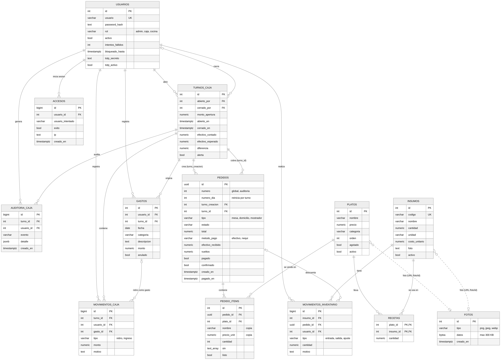

> **Pinchos la 17:** lee primero `INSTALAR_PINCHOS17.md`.

> **Versión 8:** lee `NOVEDADES_V8.md` (zonas de cocina, facturas, inversión, nuevo diseño y cómo actualizar).

# Pinchos la 17 · Sistema de pedidos, caja, cocina y contabilidad

Sistema web para el restaurante **Pinchos la 17**: los clientes piden desde el celular escaneando un QR
(en mesa o a domicilio), caja cobra en pesos colombianos con cálculo de vueltos, la cocina ve los pedidos con cronómetro,
y el administrador controla inventario, contabilidad (diaria, mensual y anual) y un recomendador anti-desperdicio.

**Tecnologías:** Node.js 22 + Express (servidor) · PostgreSQL (base de datos) · HTML/CSS/JavaScript (interfaz) · desplegado con
**GitHub + Render (servidor) + Neon (base de datos)**.

## Arquitectura
```
Navegador (celular / tablet / PC)  ──HTTP + JSON──▶  Render: Node.js + Express  ──SQL (SSL)──▶  Neon: PostgreSQL
        public/index.html                                  src/server.js                          db/schema.sql
                 ▲                                              │
                 └──────── tiempo real (Server-Sent Events) ────┘
```
Arquitectura cliente-servidor de tres capas (presentación, lógica de negocio por API REST y datos). El servidor es la única
pieza que habla con la base de datos.

## Modelo entidad-relación


Código fuente editable del diagrama: `docs/modelo-er.mmd` (Mermaid).

## Funciones principales
- **Cliente (QR):** menú con categorías y buscador, "quitar ingredientes", pedido en mesa o domicilio, seguimiento en vivo. Pago en efectivo o Nequi.
- **Caja (POS):** confirmar pedidos, cobro con billetes (2.000 a 100.000), **vueltos calculados** con su desglose, recibo, retiros e ingresos, apertura y cierre de caja con conteo por denominación.
- **Cocina (KDS):** columnas *en espera* / *en preparación*, cronómetro por pedido (verde, amarillo, rojo), casilla por plato, varios pedidos a la vez.
- **Numeración por jornada:** los pedidos vuelven a empezar en #1 en cada turno de caja; la contabilidad cuenta todos.
- **Administrador:** contabilidad con estado de resultados, ventas por hora/día/mes/año, gastos, márgenes por plato, CSV para el contador, inventario con fotos y costos, recetas, usuarios con verificación en dos pasos y alertas en tiempo real.

## Ejecutar en tu computador
Requisitos: Node 20.6+ (recomendado 22) y PostgreSQL 13+.
```bash
npm install
cp .env.example .env     # edita DATABASE_URL, JWT_SECRET, ADMIN_USUARIO y ADMIN_CLAVE
createdb pinchos17          # o crea la base vacía "pinchos17" desde pgAdmin
npm start                # http://localhost:3000
```
Con la base vacía, el sistema crea **solo** las tablas, el menú de ejemplo y el primer administrador al arrancar.

## Desplegar con GitHub + Render + Neon
Guía paso a paso: **[`DESPLIEGUE_NEON_RENDER.md`](DESPLIEGUE_NEON_RENDER.md)**. Este repositorio incluye `render.yaml`, que crea el servicio en Render casi sin configuración.
Otras guías: `DESPLIEGUE_PRODUCCION.md` (alta disponibilidad, copias, plan B) y `DESPLIEGUE.md` (servidor propio con Docker).

## Roles
| Rol | Puede |
|---|---|
| público (cliente por QR) | ver menú, crear pedido en mesa o domicilio (con la caja abierta), ver el estado de su pedido |
| cocina | ver la cola, pasar pedidos a *preparación* y *listo*, marcar platos |
| caja | flujo de pedidos, cobrar, abrir/cerrar caja, retiros, pedidos de mostrador |
| admin | todo lo anterior + inventario, menú, usuarios, contabilidad y reportes |

## Rutas principales de la API
| Ruta | Rol | Descripción |
|---|---|---|
| `POST /api/login` · `/api/logout` · `GET /api/yo` | público / sesión | inicio de sesión con cookie segura (y 2FA) |
| `GET /api/menu` · `GET /api/config` | público | menú con categorías; estado del local y tiempos de cocina |
| `POST /api/pedidos` · `GET /api/pedidos/:id/estado` | público | crear pedido (el total lo calcula el servidor) y seguirlo |
| `GET /api/pedidos` · `PATCH /api/pedidos/:id/{confirmar,avanzar,cancelar}` | cocina, caja, admin | cola activa y cambios de estado |
| `PATCH /api/pedidos/:id/pagar` | caja, admin | cobro con dinero recibido y vueltos |
| `POST /api/turno/{abrir,cerrar,movimiento}` · `GET /api/turno` | caja, admin | turnos de caja |
| `GET /api/contabilidad/{resumen,serie,margenes,exportar.csv}` | admin | contabilidad |
| `GET/POST /api/gastos` · `PATCH /api/gastos/:id/anular` | admin | gastos del negocio |
| `GET/POST/PUT/DELETE /api/insumos` · `/api/platos` | admin | inventario y menú (fotos máx. 300 KB, guardadas en la base) |
| `GET /api/reportes/{platos,consumo,recomendaciones}` | admin | más vendidos, consumo, stock sugerido |
| `GET /api/eventos` (SSE) · `GET /api/salud` | público | tiempo real y monitoreo |

Estados: `espera → preparacion → listo → (entregando, solo domicilio) → entregado` (o `cancelado`).

## Recomendador anti-desperdicio
La vista `recomendacion_stock` calcula el consumo promedio diario de los últimos 14 días y sugiere mantener ese
promedio + 15 %. Marca `reponer` si quedan menos de 2 días de stock y `exceso` si hay más de 10 días.

## Seguridad
- **Sesión:** cookie `httpOnly` + `SameSite=Strict` (el navegador no entrega el token a ningún script) y protección CSRF con cabecera obligatoria. En `NODE_ENV=production` la cookie es `Secure` y se exige HTTPS; por eso en producción necesitas HTTPS de verdad.
- **Verificación en dos pasos (TOTP):** compatible con Google/Microsoft Authenticator. Es **opcional por defecto**: cada usuario la activa (🔐) o desactiva (🔓, con contraseña + código) cuando quiera. Con `EXIGIR_2FA=admin` el administrador debe activarla al entrar. Incluye 8 códigos de recuperación de un solo uso, y un mismo código no sirve dos veces. El administrador puede restablecerla a otro usuario.
- **Contraseñas:** bcrypt, mínimo 10 caracteres con letras y números; bloqueo de 15 min tras 5 fallos; límite de intentos por IP.
- **Accesos:** historial de inicios de sesión (exitosos y fallidos) y aviso en tiempo real al administrador ante cuenta bloqueada o ingreso desde red/dispositivo nuevos.
- **Base de datos:** `scripts/crear-usuario-bd.js` crea un usuario con permisos mínimos (no puede borrar tablas, ni borrar/editar la auditoría, ni crear usuarios). Los turnos cerrados y la auditoría están protegidos incluso contra el administrador de la base.
- **Pedidos de clientes:** con `CONFIRMAR_PEDIDOS=true` (por defecto) un pedido hecho por QR o domicilio espera a que caja lo confirme antes de llegar a cocina. Evita pedidos falsos desde fuera del local.
- **Otros:** cabeceras `helmet`/CSP, consultas parametrizadas, validación de datos y fotos, precios calculados en el servidor, tiempo máximo de consulta (15 s), registro de accesos sin datos sensibles, cierre de sesión por inactividad (30 min en caja y admin), cierre ordenado del servidor y `/api/salud` para monitoreo.
- Nunca subas el archivo `.env` a GitHub (ya está en `.gitignore`).

## Caja: apertura, cierre y seguridad (turnos)
- **Apertura:** caja indica con cuánto efectivo empieza. Sin una caja abierta no se puede cobrar. Solo puede haber **un turno abierto** a la vez (lo garantiza la base de datos).
- **Aviso al administrador:** en tiempo real aparece un banner en su pantalla, con sonido (apertura, cierre, retiros, diferencias y turnos demasiado largos). El canal en vivo solo avisa que hubo un cambio; los datos se piden con sesión, así que no se filtran.
- **Retiros e ingresos de efectivo:** con motivo obligatorio. Un retiro mayor a `CAJA_UMBRAL_RETIRO` se marca como alerta.
- **Cierre a ciegas:** el cajero cuenta y escribe el efectivo; el sistema calcula lo esperado (base + ventas en efectivo + ingresos − retiros) y muestra la diferencia. El cajero no ve el "esperado" antes de contar. Si la diferencia supera `CAJA_UMBRAL_DIFERENCIA`, el admin recibe una alerta en rojo.
- **No se cierra con deudas:** si hay pedidos entregados sin cobrar, el cierre se bloquea.
- **Inmutable:** un turno cerrado y la bitácora de auditoría (usuario, hora, IP y dispositivo) no se pueden editar ni borrar, ni siquiera desde la base de datos.
- **Admin:** pestaña "Turnos" con el turno en vivo, historial de cierres con diferencias y eventos recientes.
- Cada venta queda asociada al turno donde se cobró; así el cierre no depende de la hora del reloj ni de la medianoche.

## Estructura del repositorio
```
src/server.js        servidor Express (rutas, reglas de negocio)
src/arranque.js      crea tablas, migraciones y primer administrador al arrancar
src/conexion.js      ajusta la conexión a Neon (usa siempre la dirección directa)
src/totp.js          verificación en dos pasos
public/index.html    interfaz web (cliente, caja, cocina, administrador)
db/                  schema.sql, seed.sql y migraciones
scripts/             crear usuarios, copias de seguridad, limpieza de pruebas
docs/                diagrama entidad-relación
render.yaml          despliegue en Render
```
